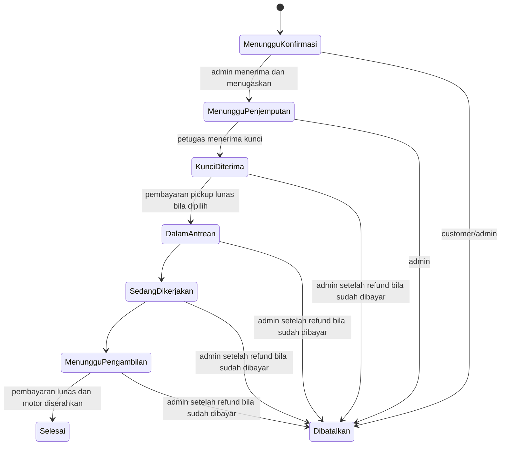
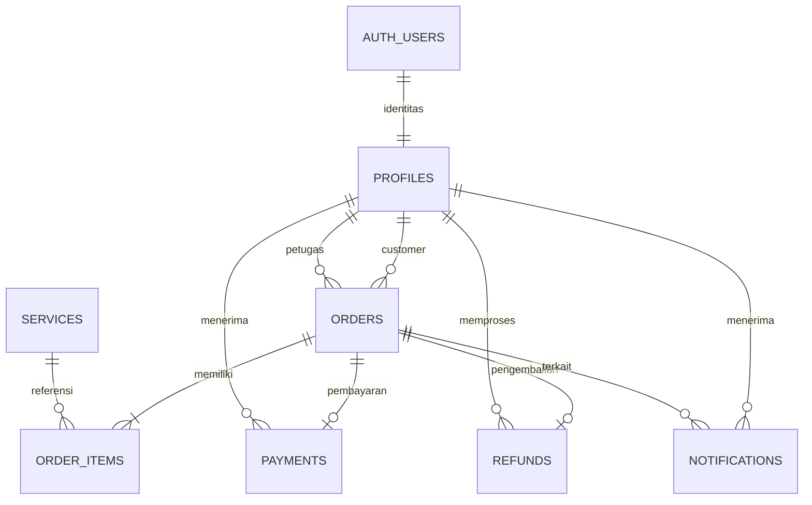

# STEAM YADIKA — Arsitektur dan Keputusan Sistem Final

Dokumen ini mendefinisikan perilaku sistem yang menjadi acuan frontend, PostgreSQL, Edge Functions, pengujian, dan SOP operasional. Proyek tetap satu aplikasi STEAM YADIKA.

## 1. Prinsip desain

1. Satu sumber kebenaran data operasional adalah PostgreSQL Supabase. Tampilan browser tidak boleh menganggap perubahan berhasil sebelum server mengonfirmasi.
2. Hak akses ditegakkan pada database (RLS dan RPC), bukan hanya dengan menyembunyikan tombol.
3. Identitas warga sekolah dipisahkan dari role operasional.
4. Pembayaran di aplikasi adalah pencatatan uang yang diterima petugas, bukan payment gateway.
5. Harga pesanan merupakan snapshot sehingga perubahan katalog tidak mengubah transaksi terdahulu.
6. Tindakan yang memengaruhi uang, akun, status, dan katalog harus dapat diaudit.
7. Data transaksi tidak disimpan di cache offline. Aplikasi memerlukan koneksi internet untuk membaca/menulis data operasional.

## 2. Model identitas dan akses

| Role | Identitas warga sekolah | Akses utama |
|---|---|---|
| `member` | `student`, `teacher`, `employee` | Memesan layanan dan melihat pesanan/notifikasi milik sendiri |
| `staff` | Umumnya `employee` | Melihat pekerjaan yang ditugaskan, memperbarui progres, mencatat pembayaran tugas sendiri |
| `admin` | Umumnya `employee` | Verifikasi, akun, katalog, harga pesanan, penugasan, transaksi, pembatalan, refund, laporan |
| `leadership` | Umumnya `employee` | Ringkasan agregat; tidak bisa membaca data pribadi pesanan |

`member_type` menjawab “siapa pengguna di sekolah”; `role` menjawab “apa yang boleh dilakukan di aplikasi”. Pengguna operasional tetap dapat memesan sebagai warga sekolah apabila memiliki `member_type`.

## 3. State machine pesanan

Transisi dijalankan melalui RPC `admin_assign_order` dan `staff_update_order_status`. Pelompatan status tidak diizinkan. Customer hanya dapat membatalkan ketika status masih `Menunggu konfirmasi`.

## 4. Model pembayaran

Dua pilihan customer terpisah dan tidak saling menentukan:

| Metode | Saat kunci dijemput | Setelah layanan selesai |
|---|---|---|
| Cash | Petugas menerima uang ketika mengambil kunci | Petugas menerima uang saat motor diambil |
| QRIS | Petugas memeriksa transaksi ketika mengambil kunci | Petugas memeriksa transaksi saat motor diambil |

Tahap pencatatan ditentukan oleh `payment_timing`; metode pencatatan harus cocok dengan `payment_method` pesanan. Pada migrasi transaksi lunas dari skema lama, transaksi tanpa petugas penerima tetap dipertahankan untuk akurasi laporan dan diberi penanda penerima historis tidak tercatat; transaksi baru selalu merekam petugas yang login. `record_payment` memeriksa peran admin/petugas yang ditugaskan, status order, tahap pembayaran, harga, nominal, dan keunikan transaksi. Pembayaran tidak dapat dicatat sebelum dana benar-benar diterima atau QRIS berhasil diverifikasi.

### Pengembalian dana

Admin dapat mencatat pengembalian penuh satu kali per pesanan lunas setelah uang benar-benar dikembalikan di luar aplikasi. `record_refund` mengunci baris pesanan, mengambil nominal dari riwayat pembayaran, menyimpan metode/alasan/pemroses/waktu, dan mengubah status pembayaran menjadi `Dikembalikan`. Pesanan yang belum selesai sekaligus ditutup sebagai `Dibatalkan`. Refund sebagian belum didukung.

## 5. Relasi data utama

Tabel inti: `profiles`, `services`, `orders`, `order_items`, `payments`, `refunds`, `notifications`, `audit_logs`, dan `registration_attempts` (service-role only).

## 6. Batas data dan keamanan

- Customer: hanya order, item, pembayaran, refund, dan notifikasi miliknya.
- Petugas: hanya order yang ditugaskan kepadanya beserta detail operasional terkait.
- Admin: akses operasional penuh dan data akun untuk pengelolaan.
- Pimpinan: laporan agregat melalui `management_summary`; tidak diberi akses langsung ke detail order.
- Akun nonaktif, belum terverifikasi, dipaksa mengganti password, atau memakai JWT yang lebih lama dari `session_valid_after` gagal pada `current_role()`.
- Password sementara hanya dapat dilepas setelah Supabase Auth mengubah hash password; trigger database yang melakukan perubahan flag.
- Perubahan katalog, status, harga pesanan, transaksi, refund, akun, dan tindakan penting lain masuk `audit_logs`.
- QRIS/Cash dikonfirmasi manusia; aplikasi tidak menyimpan kredensial pembayaran atau mengklaim verifikasi bank otomatis.

## 7. Laporan dan waktu

Semua filter periode laporan memakai zona `Asia/Jakarta`. Volume pesanan dikelompokkan berdasarkan `orders.created_at`; penerimaan berdasarkan `payments.received_at`; pengembalian berdasarkan `refunds.refunded_at`. Pendapatan bersih adalah kas masuk dikurangi kas keluar melalui refund pada periode kejadian masing-masing. Komposisi Cash/QRIS dan pilihan waktu bayar ditampilkan terpisah.

## 8. Asumsi dan batas implementasi

- Refund hanya penuh, bukan parsial.
- Perubahan metode pembayaran setelah pesanan dibuat belum tersedia; petugas harus mengikuti metode pilihan customer atau meminta admin menyelesaikan perubahan sesuai SOP sekolah sebelum uang diterima.
- Sistem memerlukan internet untuk transaksi. PWA hanya menyimpan shell statis.
- Verifikasi warga sekolah dilakukan admin; integrasi daftar induk siswa/pegawai belum tersedia.
- Backup, restore, monitoring, CAPTCHA/WAF, kebijakan privasi/retensi, dan uji perangkat nyata adalah tanggung jawab deployment sekolah dan harus diselesaikan sebelum go-live.
- Project Supabase, URL, public key, domain, secrets, akun admin, dan harga resmi belum dapat diisi tanpa akses pemilik sistem.
